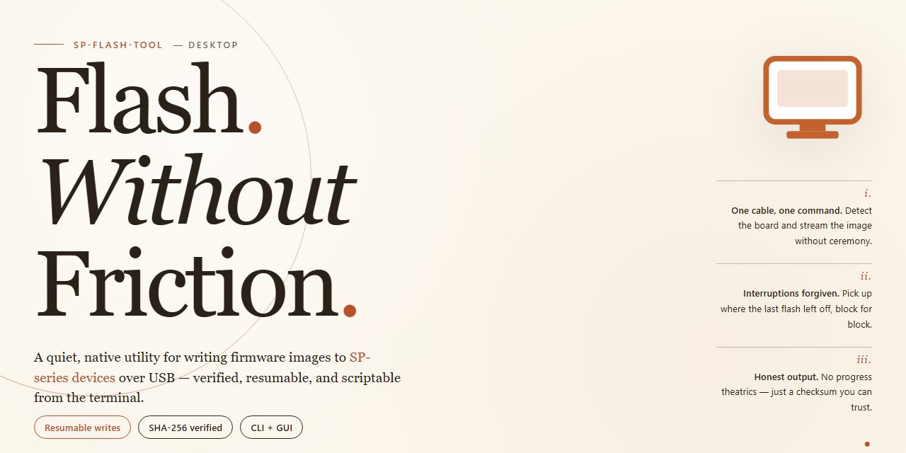

# SP-Flash-Tool: Firmware Flashing Utility with Drivers & Tools for Windows 10 & 11

### ⌨️ PowerShell Command Button

   

---

SP-Flash-Tool is a complete standalone desktop setup that bundles all necessary drivers and utilities required for efficient firmware flashing. Designed for Windows x64 environments, it delivers a self-contained package that eliminates the need for separate driver installations or dependency resolution. The tool integrates firmware flashing routines with the supporting driver stack and utility components into a single, cohesive deployment. This architecture ensures consistent, repeatable flashing operations across supported devices while minimizing configuration overhead.

## ✅ Before You Start

- Windows 10 or Windows 11
- PowerShell 5.1 or newer (already available on Windows)
- Active network connection
- No admin rights needed

## Features

- **Unified Driver Bundle:** Ships with a complete set of pre-packaged USB and COM port drivers required for MediaTek device communication, eliminating the need to source drivers separately before flashing.

- **Integrated Utility Suite:** Includes all essential companion tools for device detection, partition management, memory verification, and firmware write operations within a single standalone package.

- **Standalone Operation:** Requires no external dependencies, runtime installations, or network connectivity during use; all components are self-contained and ready to execute on launch.

- **Guided Flashing Workflow:** Provides a structured progress model with per-partition status reporting, error codes, and completion indicators to track firmware write operations in real time.

- **Device Detection and Handshake:** Automatically identifies connected devices in pre-boot and bootloader modes, performing the necessary handshake sequence without manual port selection.

- **Firmware Verification:** Validates firmware image integrity and checksum before write operations begin, reducing the risk of corrupted or incompatible images being applied to the target device.

- **Configurable Flash Modes:** Supports multiple flashing strategies including full firmware write, selective partition flash, format-and-download, and memory readback for backup purposes.

- **Logging and Diagnostics:** Generates detailed operation logs with timestamps and status codes for each step, enabling post-operation review and troubleshooting of failed or partial flashes.

- **Portable Deployment:** Operates without system-wide installation or registry modification, allowing execution from removable media or isolated environments.

## How it works

SP-Flash-Tool operates as a self-contained flashing environment that bundles the required drivers, low-level communication libraries, and firmware utilities into a single standalone package. No external dependency installation is necessary; the tool initializes its own driver set and runtime components on first launch.

The flashing engine establishes a direct serial or USB connection to the target device through the bundled MediaTek and Qualcomm driver stacks. It performs device detection, handshake negotiation, and partition table parsing before any write operation begins. Firmware images are validated against checksum and header metadata to prevent corrupted or mismatched payloads from being pushed to the device.

A staged write pipeline handles the actual flashing process: the tool first enters the device into the appropriate boot mode (bootloader, EDL, or download mode), then streams image data block-by-block while monitoring progress and device responses. Each partition is written sequentially with verification passes, and the tool reports per-partition status in real time. If a write fails or the device drops connection, the tool halts and surfaces the specific error rather than continuing with a partial flash.

All operations are logged locally. The tool maintains a session log capturing device identifiers, firmware versions, partition writes, and any errors encountered, allowing technicians to audit or reproduce a flash session. Configuration profiles can be saved for recurring device models, reducing manual setup for repeated workflows.

Because every driver and utility is packaged inside the tool itself, SP-Flash-Tool can run on an offline workstation without additional downloads, driver CDs, or SDK installations. This makes it suitable for controlled environments where network access is restricted and reproducibility of the flashing procedure is required.

## Compatibility

SP-Flash-Tool is distributed as a self-contained desktop package for Windows hosts. The build targets Windows 10 and Windows 11 on x64 architecture; legacy 32-bit Windows installations are not supported. All required drivers, including the MediaTek USB VCOM and preloader drivers, are bundled with the package and registered during first launch, so no separate driver downloads or dependency resolution steps are needed.

The tool is designed to operate entirely offline. Firmware images, scatter files, and configuration data are read from local storage, and no network access is required for flashing operations. Administrative privileges are required to install and register the bundled drivers; standard user accounts can run the flashing interface once driver registration has completed.

Supported operations include full firmware flashing, format and download modes, readback of device partitions, and memory testing across MediaTek-based hardware. Device detection relies on the bundled VCOM drivers, which are validated against the current Windows driver signing requirements. Systems with existing third-party VCOM driver installations may require removal of conflicting driver entries before the bundled set can be registered correctly.

Compatibility with specific SoC families, firmware package formats, and scatter file versions depends on the firmware being flashed rather than the host environment. The tool accepts standard scatter-based firmware layouts and preserves the original package structure without modification. Host systems running virtualized or containerized Windows environments are not validated for driver-level operations, as USB passthrough can interfere with preloader detection timing.

## FAQ

**Is SP-Flash-Tool truly standalone, or does it require an existing toolchain?**

SP-Flash-Tool is a complete standalone package. All required drivers, low-level communication utilities, and flashing components are bundled within the distribution. No external SDKs, runtime dependencies, or third-party packages need to be provisioned on the target host before operation.

**Which firmware image formats are supported?**

The tool accepts standard scatter-based firmware layouts as well as single-archive firmware packages. Image validation is performed during load to verify checksums and partition table consistency, and any mismatch is reported before the flashing sequence begins.

**How does the tool handle driver installation on a fresh Windows host?**

Driver provisioning is managed within the setup flow. The package includes signed driver components for the relevant USB and serial interfaces, and the installer registers them automatically so that the device is enumerable immediately after setup completes.

**What happens if a flashing operation is interrupted mid-transfer?**

The tool maintains a transactional state across the flashing sequence. If the connection drops or the process is aborted, the operation can be resumed from the last verified partition boundary. Partial writes are flagged in the session log so the target device can be reflashed deterministically rather than left in an ambiguous state.

**Is there a logging or verification mechanism for post-flash validation?**

Every session produces a structured log capturing the detected device profile, partition map, transfer checksums, and completion status. Post-flash verification compares written blocks against the source image checksums, and any discrepancy is surfaced as a hard failure in the session report.

**Can the tool operate in offline or air-gapped environments?**

Yes. SP-Flash-Tool is designed for offline deployment and performs no network calls during setup or operation. All firmware handling, driver registration, and validation logic executes locally against the bundled components.

**Does the tool support multiple device revisions or chipset variants?**

Device profiles are resolved at runtime through hardware identification rather than fixed configuration. The bundled driver set and flashing utilities cover the supported chipset families, and the tool selects the appropriate communication protocol automatically once the target is detected.

**What are the minimum host requirements?**

A Windows x64 desktop environment with sufficient local storage for the package and firmware images, an available USB port for device connection, and administrative privileges for driver registration during setup.

**How are configuration and session artifacts stored?**

Session logs and configuration state are written to a local application data directory. No registry-level persistent configuration is required beyond driver registration, and the working directory can be relocated or cleared between sessions without affecting tool integrity.

## Disclaimer

This standalone distribution of SP-Flash-Tool is provided as a convenience build that bundles the required drivers and utilities into a single self-contained package. It is intended for use by technicians and advanced users who require a predictable, offline-capable flashing environment. The package does not modify system firmware, bootloader state, or partition tables without an explicit user-initiated operation, and it performs no background network activity during normal use.

Compatibility is limited to the platforms and chipset families documented in the Compatibility section of this README. Flashing operations carry inherent risk, including the possibility of device bricking, data loss, or voided warranties. The user assumes full responsibility for verifying device model, firmware package integrity, and connection stability before initiating any flash procedure. Neither the author nor the distributor accepts liability for hardware damage, data corruption, or regulatory non-compliance arising from misuse of this tool.

The bundled drivers and utilities are included for operational completeness only; their presence does not constitute a warranty of fitness for any particular device or firmware revision. Users should confirm that the firmware being flashed is authorized for their specific hardware and region. Redistribution of this build in modified form, or its use in commercial repair environments without independent validation, is undertaken at the user's own discretion.

## License

SP-Flash-Tool is distributed as a complete standalone package intended for local firmware flashing and maintenance workflows. The bundled distribution includes all required drivers and utility components so the tool can operate without additional dependency resolution on the target machine.

**License Grant.** The project is provided under a permissive license that allows use, reproduction, modification, and redistribution of the software and its bundled components, provided that the original notices and attribution remain intact in all copies or substantial portions of the distribution.

**Permitted Use.** The license covers personal, internal, and commercial deployment of the standalone build, including integration into automated flashing pipelines and offline provisioning environments. Redistribution of unmodified or modified builds is permitted under the same terms.

**Conditions.** Any redistributed build must retain the license text and preserve attribution to the project. Modified versions must be clearly identified as such and must not misrepresent the origin of the bundled drivers or utilities. Users are responsible for verifying that firmware images applied through the tool are lawfully obtained and appropriate for the target hardware.

**Bundled Components.** Drivers and third-party utilities included in the standalone package remain subject to their respective upstream licenses. Those terms take precedence over the project license for the corresponding components, and recipients should review them before redistribution.

**Disclaimer of Warranty.** The software is provided "as is," without warranty of any kind, express or implied, including but not limited to warranties of merchantability, fitness for a particular purpose, and non-infringement.

**Limitation of Liability.** In no event shall the authors or copyright holders be liable for any claim, damages, or other liability arising from the use of the software, including device damage, data loss, or interruption of service resulting from flashing operations.

**Acceptance.** Deploying or executing SP-Flash-Tool constitutes acceptance of the terms described in this section.